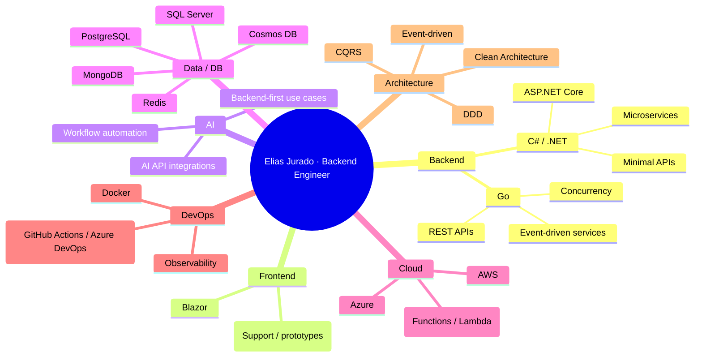

# .NET + Go Backend Engineer

Construyo APIs y microservicios con **C#/.NET** y **Go** en cloud.

**Core stack:** `.NET` · `Go` · `Cloud` · `AI`

## Focus
- Backend development with **.NET** and **Go**
- Cloud-native architecture and microservices
- AI integrations for real product workflows

## Tech Stack Map

